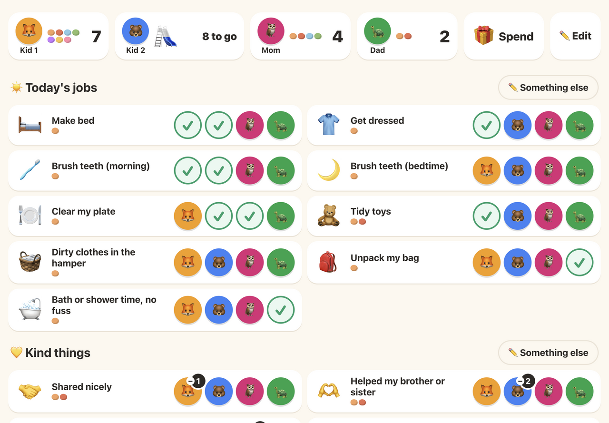

# Pebblepot

A family board for rewarding kids for chores and good behaviour with **pebbles** they can save up and spend.

One shared screen, made for the kitchen iPad first, that anyone in the family can tap. There are no accounts, sign-ins or cloud services. It runs on your own computer or home server and keeps an honest record of who did what.



## What it does

- **Pots:** the top strip shows every family member's pot, with their face, a few pebble dots and the total. A pot that's saving for a goal shows the goal's picture filling up, with "N to go".
- **☀️ Today's jobs:** daily chores. Tap the face of whoever did it, and it turns into a ✓. Tap the ✓ to undo.
- **💛 Kind things:** good deeds. These can happen more than once a day, and a badge on each face counts them.
- **🧺 Other jobs:** occasional chores, with a search box.
- **✏️ Something else:** adds a new chore or good deed and gives the pebbles in one step.
- **🎁 Spend:** pick whose pebbles, then a reward. A reward someone can't afford yet shows "🔒 N more to go" and offers **⭐ Save for this**.
- **Today list:** tap a pot to see that person's entries for today and undo any of them. Once a day is over, it can't be changed.
- **✏️ Edit:** rename, re-price, reorder or retire chores and good deeds.
- **Live sync:** every open device updates straight away, so a tap on a phone shows up on the iPad.

Pebbles are only ever earned or spent, never taken away as punishment. [GLOSSARY.md](GLOSSARY.md) explains the vocabulary.

## Running it

You need [Rust](https://rustup.rs) 1.95 or later. SQLite is bundled, so there's nothing else to install.

```sh
git clone git@github.com:dialtone/pebblepot.git
cd pebblepot
cargo run --release
```

Open **http://127.0.0.1:8070**. On first start, Pebblepot creates `./data/`, sets up the database and fills the board with starting family members, chores, good deeds and rewards. Later starts reuse that data.

### Using it from an iPad or phone on your home network

By default Pebblepot only accepts connections from the computer it runs on. To reach it from other devices on your Wi-Fi, listen on every interface:

```sh
PEBBLEPOT_LISTEN_ADDR=0.0.0.0 cargo run --release
```

Then open `http://<your computer's LAN IP>:8070` on the iPad. On macOS, `ipconfig getifaddr en0` prints that IP. A DHCP reservation on your router keeps the address from changing.

### Settings

Every setting is an environment variable with a working default.

| Variable | Default | What it does |
|---|---|---|
| `PEBBLEPOT_LISTEN_ADDR` | `127.0.0.1` | Address to listen on. Use `0.0.0.0` for your home network. |
| `PEBBLEPOT_PORT` | `8070` | Port to listen on. |
| `PEBBLEPOT_DATA_DIR` | `./data` | Folder for the SQLite database. |
| `PEBBLEPOT_TIME_ZONE` | the computer's time zone | IANA time zone, such as `Europe/Rome`. It decides when "today" starts and ends. |

### Docker

The image contains only the compiled binary. Templates, migrations, static files and time-zone data are all built into it.

```sh
docker build -t pebblepot .
docker run -d --name pebblepot -p 8070:8070 \
  -v "$PWD/data:/data" \
  -e PEBBLEPOT_TIME_ZONE=Europe/Rome \
  pebblepot
```

The container runs as user `10001:10001`, so the mounted `data` folder must be writable by that user. Always set `PEBBLEPOT_TIME_ZONE`, because without it the container uses UTC.

## Your data

Everything lives in one SQLite database in the data folder, along with its `-wal` and `-shm` files. To back up while the app is running, use SQLite's online copy rather than copying the files:

```sh
sqlite3 data/pebblepot.sqlite3 "VACUUM INTO 'pebblepot-backup.sqlite3'"
```

To start over with fresh starting content, stop Pebblepot, delete the data folder and start it again.

## Development

```sh
cargo test                   # unit tests and HTTP-level tests
cargo clippy --all-targets   # lints
cargo fmt                    # formatting
```

The stack is [axum](https://github.com/tokio-rs/axum) for the server, [askama](https://github.com/askama-rs/askama) templates, [htmx](https://htmx.org) with server-sent events for live updates, and SQLite through [rusqlite](https://github.com/rusqlite/rusqlite).

```text
src/
├── main.rs     # startup, settings, graceful shutdown
├── lib.rs      # crate root, used by the binary and the tests
├── config.rs   # environment variables and defaults
├── store.rs    # SQLite connection and migrations
├── seed.rs     # starting content on first run
├── rules.rs    # every command: earn, undo, redeem, goals, edits
├── board.rs    # read model for the board, today list and rewards
├── web.rs      # routes, templates and live sync
├── clock.rs    # controllable clock for tests
└── model.rs    # shared types
migrations/     # SQL migrations, applied on start
templates/      # askama HTML templates
static/         # CSS, vendored htmx and small scripts
tests/          # tests that drive the app through HTTP
```

Planning and tickets live as Markdown under `.scratch/`, and domain terms are in [GLOSSARY.md](GLOSSARY.md). [AGENTS.md](AGENTS.md) explains how coding agents work in this repo.

## License

[MIT](LICENSE)
